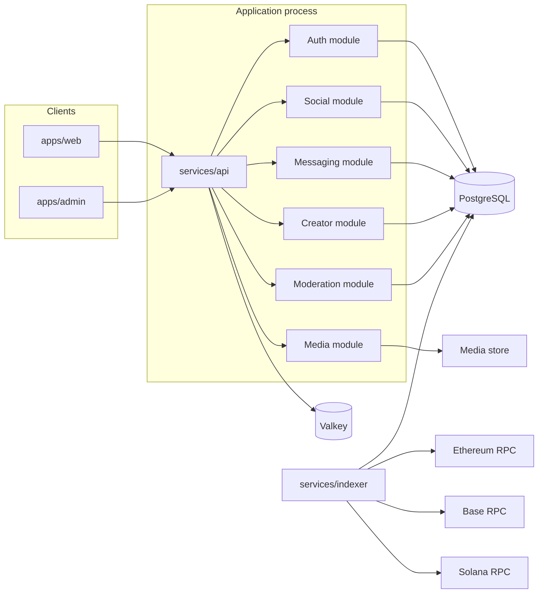

# EraX Digital — Target Architecture

Status: accepted for implementation after the 2026-11-03 audit.

This architecture fits an empty repository. It does not describe a running deployment. Contracts and programs in this document are designs to be written and tested locally. They are not deployed, and they are not audited.

## Decisions

| Decision | Choice | Reason |
| --- | --- | --- |
| Repository shape | One pnpm monorepo | Shared types, one lockfile, one CI entry |
| Application topology | Modular monolith plus one chain worker | The assignment allows a monolith for application services and a separate indexer. Separate network services for social, identity, wallet, creator, and notifications would add failure modes without a current scale requirement |
| HTTP framework | Fastify 5 in `services/api` | WebSockets and HTTP in one process. MIT license |
| Web and admin UI | Next.js in `apps/web` and `apps/admin` | RainbowKit’s supported React environment. Admin is a separate app so moderation routes are not shipped as anonymous website routes |
| Mobile | No app in the first implementation | No existing mobile client, and a shell with dead navigation would violate the assignment |
| Database | PostgreSQL 16 | Relational social data, foreign keys, full-text search |
| ORM | Drizzle | SQL stays visible for `tsvector`, cursor pagination, and transactions. Migrations are reviewed SQL. Apache-2.0. Prisma was the alternative and was not selected |
| Cache and limits | Valkey | Redis protocol without Redis’s current server license |
| Jobs | PostgreSQL `SKIP LOCKED` job table | Email and indexing backfill do not justify Kafka or a second queue system |
| Object storage | Local filesystem driver in development. S3 API in deployed environments | Media is not stored in database rows. MinIO’s AGPL server is not embedded |
| EVM | Solidity, Foundry, OpenZeppelin 5.7, viem, wagmi 2, RainbowKit | Matches the permissive stack verified in the audit |
| Solana | Rust, Anchor 0.31 stable, Wallet Adapter, `@solana/web3.js` 1.x | Matches the adapter. `@solana/kit` waits until the adapter path supports it |
| Wallet shell | One EraX wallet screen that hosts both connectors | AppKit is excluded by license. The chains stay separate under the screen |
| Chain login | SIWE and SIWS, server-verified | A submitted address is not a session |
| On-chain social graph | Off-chain in PostgreSQL | Follows are high-volume. The assignment asks that this be a real choice. On-chain follows can be added later if a product rule requires public verification |
| Token | None | No authorization to launch one |
| Upgrade proxies | None in the first contracts | Proxies add an admin key before any independent audit. A flawed deployment is replaced by a new address |
| Platform fee | Storage for a basis-point value, initializer `0` | Production percentages need an explicit product decision |
| Realtime | WebSocket on the API process | Messages and notifications. Not described as end-to-end encrypted |
| Search | PostgreSQL full-text search | A separate search engine needs a measured reason |

## System



The browser talks to Ethereum, Base, and Solana directly for signatures and user-submitted transactions. The API never holds a wallet private key or seed phrase. The indexer only reads chain data and writes normalized rows.

## Repository layout

```text
EraX/
├── apps/
│   ├── web/                  Social, creator, wallet, settings
│   └── admin/                Reports, takedowns, suspensions
├── services/
│   ├── api/                  HTTP, WebSocket, OpenAPI, workers client
│   └── indexer/              Ethereum, Base, and Solana readers
├── packages/
│   ├── ui/
│   ├── database/             Drizzle schema and SQL migrations
│   ├── shared-types/
│   ├── authentication/
│   ├── wallet-core/          Shared address, amount, and tx status types
│   ├── wallet-evm/
│   ├── wallet-solana/
│   ├── blockchain-common/    Normalized chain event types
│   ├── api-client/
│   └── configuration/        Env parsing with Zod
├── blockchain/
│   ├── evm/                  Foundry project
│   └── solana/               Anchor workspace
├── infrastructure/
│   ├── docker/
│   └── deployment/
├── docs/
├── scripts/
├── .github/workflows/
├── docker-compose.yml
├── pnpm-workspace.yaml
└── README.md
```

`apps/mobile` is omitted until there is a real client. Identity, social, wallet, creator, notification, and media are modules inside `services/api`, not deployable services. The indexer is the one extra process, because it holds long-lived RPC subscriptions and must restart independently of request serving.

## Request path

Every mutating route:

1. Parses the body with Zod.
2. Resolves the session from an HttpOnly cookie, or rejects the call.
3. Checks role, block list, and ownership on the server.
4. Writes in a database transaction.
5. Enqueues notifications in the same transaction.
6. Returns a stable error shape: `code`, `message`, `details`.

Cursor pagination uses `(created_at, id)` or an equivalent unique key. Offset pagination is not the feed API.

## Identity

Two login methods share one user.

Email:

- Registration stores an Argon2id password hash.
- Verification and reset tokens are random, hashed at rest, and short-lived.
- Sessions have an expiry and a server-side revocation list.
- Login, register, and reset routes are rate-limited.

Wallets:

- The server creates a challenge row: nonce, domain, chain, address, expiry.
- The wallet signs a SIWE or SIWS message.
- The server checks domain, expiry, nonce single-use, and the signature against the claimed address.
- A verified wallet can link to an existing user or create one.
- One user may link many addresses. An address belongs to one user.

Profile fields that are personal stay in PostgreSQL. The chain stores a profile reference and the controlling wallet, not a biography, email, or image.

Reserved usernames include administrative and brand names (`admin`, `erax`, `support`, `system`, and a short reviewed list). Uniqueness is case-insensitive.

## Social data

Core tables, all with foreign keys, timestamps in UTC, and the indexes their access paths need:

- `users`, `profiles`, `sessions`, `email_tokens`
- `wallets`, `wallet_auth_challenges`
- `posts`, `post_media`, `comments`, `likes`, `reposts`, `bookmarks`, `follows`
- `conversations`, `conversation_members`, `messages`
- `notifications`, `notification_preferences`
- `creators`, `subscriptions`, `tips`, `content_entitlements`
- `blockchain_transactions`, `blockchain_events`
- `reports`, `moderation_actions`, `blocks`, `audit_logs`
- `jobs`

Posts can be edited and soft-deleted. Media rows store object keys, content type, and size. The bytes live in the media store. Upload routes check type and size and rate-limit the caller.

Mentions and hashtags are parsed on write and stored so search does not depend on scanning post text at read time. PostgreSQL `tsvector` covers post and profile search.

Direct messages are server-visible. The product must not call them end-to-end encrypted. Delivery is a WebSocket event plus a stored row. Read receipts update the membership row. Blocks prevent new messages.

## Chains

EVM and Solana do not share accounts, signatures, or token programs. `packages/wallet-core` defines a normalized transaction only after each chain package has produced a chain-specific result.

Normalized statuses: `pending`, `confirmed`, `failed`, `reverted`, `finalized`.

The indexer deduplicates by `(chain_id, transaction_hash, log_index_or_instruction_index)`. EVM confirmation depth is configurable per network. A reorg that drops a transaction marks the stored row failed or removed rather than leaving a false confirmation. Solana finalized status is stored separately from processed or confirmed when the RPC reports it.

The indexer watches EraX contract and program events, plus the addresses of linked wallets for native and configured token transfers. It does not try to index either chain in full.

### EVM contracts

Three contracts, one Foundry project, OpenZeppelin 5.7:

1. `EraXProfileRegistry` — wallet registers a profile id it controls, can rotate the controller, emits events. No personal data.
2. `EraXCreatorPayments` — creator registration, subscriptions, tips, configurable fee in basis points, withdrawals, pause. Payments are native coin or an allowlisted ERC-20. Fee initializer is `0`.
3. `EraXContentAccess` — records that an account holds an entitlement for a content id until an expiry. The content itself is not on-chain.

`EraXPaymentRouter` is not included. One payment contract is enough. No EraX token contract is included.

Local deployment is Anvil. Testnet deployment is scripted and refuses to run unless the operator sets an explicit environment flag. Mainnet deployment is not scripted as a default.

### Solana programs

Two programs:

1. `erax_identity` — profile PDA, authority wallet, user-controlled update, events via Anchor.
2. `erax_creator` — creator account, subscription and tip payments in SOL, optional allowlisted SPL mints, fee config defaulting to zero, withdrawal by the creator authority.

`erax_social_graph` is not built. Follows stay in PostgreSQL. `erax_assets` is not a third program until asset registration has a product rule beyond “show wallet balances,” which RPC reads already cover.

Token-2022 is not used unless a specific allowlisted mint requires it. That case is out of the first release.

## Wallet experience

`apps/web` wallet routes:

- Connect and disconnect Ethereum, Base, and Solana.
- Show the active address, network, native balance, and configured token balances read from RPC.
- Refuse unsupported networks and offer an explicit switch where the wallet supports it.
- Receive screen with address, copy, and QR.
- Send screen with simulation where the chain supports it, fee estimate, recipient confirmation, and a signature that happens only after the user confirms.
- History from the indexer, with pending, confirmed, failed, and reverted states.

Amounts are integers in the asset’s base units. Decimals are a display concern. The client does not submit a transaction that the user has not confirmed, and the server never signs one.

Balances and history that the RPC did not return are shown as unavailable, not as zero invented for layout.

## Creator payments

A creator profile is an application record plus an optional on-chain registration.

Subscription and tip flows:

1. The client builds the chain transaction and shows the amount, asset, and recipient.
2. The user signs and submits.
3. The API stores a pending payment row keyed by chain transaction id.
4. The indexer observes the contract or program event and marks the row confirmed or failed.
5. Entitlements are granted from confirmed events, not from the client’s claim that a transaction succeeded.

Refund behavior is limited to what the contract actually implements. If a rule is not specified, the contract does not promise a refund.

## Moderation

Users can report posts, comments, profiles, and messages, and can block other users. Blocks are enforced in feed, search, and messaging queries.

Admin users, stored as a role rather than a hidden client flag, can hide content, suspend users, and read the audit log. Every moderation write inserts an `audit_logs` row in the same transaction.

Spam controls in the first release are rate limits, duplicate-content throttles, and new-account limits. They are heuristics, not a claim of comprehensive spam detection.

## Environments

| Environment | Chains | Data |
| --- | --- | --- |
| Local | Anvil and `solana-test-validator` | Docker Compose: PostgreSQL, Valkey, Mailpit, API, web. Seed data is labeled test data |
| Testnet | Ethereum Sepolia, Base Sepolia, Solana devnet | Separate env file. RPC URLs come from the environment |
| Production | Not configured in the first implementation | Requires its own env, backups, and an explicit deploy decision |

RPC credentials are environment variables. No provider key is committed.

## Observability

- Liveness and readiness on `/health` and `/ready`.
- JSON logs with request id.
- Database migration status exposed to readiness.
- Error reporting hooked behind an interface. No vendor key is required for local development.

## What this architecture refuses to add without a new decision

- A native token.
- Kafka, Kubernetes, or a microservice per feature.
- Upgradeable proxies.
- Custodial wallets.
- End-to-end encrypted messaging.
- On-chain storage of private content or personal profile fields.
- Mainnet deployment.
- A claim that the contracts have been audited.
